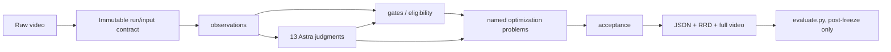

# `refactor/rl-opt` 整理后管线基线

> **基线日期**：2026-09-15
> **上游分支**：[`DexGEM-Lab/ego_annotation@refactor/rl-opt`](https://github.com/DexGEM-Lab/ego_annotation/tree/refactor/rl-opt)
> **不可变源码基线**：`3d63360f17044772abd26e867747b45b7a340502`
> **对比起点**：`12aede8eaa2a945150b3de9bd3d0f81461d408b4`
> **最新基线提交内容**：在 input identity 中记录原始 source video 与 sensor calibration 的解析后 NAS/源路径；上一提交已在 standalone `annotation.json` 中加入每侧 21×3 `joints_world`。
> **用途**：这是后续修改、优化、消融和回归比较的默认源码基线；分支名会移动，比较时必须引用上述 commit SHA。

## 0. 先读结论

1. 当前仓库已经从“数百个版本脚本与实验入口”收敛为一个 **grouped package**：
   `observations/`、`gates/`、`factors/`、`optimization/`、`utils/`，业务入口统一为 `main.py`。
2. 默认 cold 管线已经在代码上接通：原始视频 → 新观测 → Astra 判断 → SAM3D 完整物体表面 → observed/RGB pose → MANO/object visual fit → 全时长 JSON/RRD/MP4。
3. cold `annotate` 的输出是**完整、可渲染的视觉候选**，但当前实现明确固定：
   `annotation_ready=false`、`physical_contact_authority=false`。视觉检查通过不等于物理标注通过。
4. 正式物理候选走另一条 prepared `formal-tail`：正式 object pose、signed geometry、formal MANO、acceptance、shared render。它与 cold visual fit 不能混为一谈。
5. 当前 HEAD 的 CPU contract 已较完整，但 README/MIGRATION 明确说明：**该 checkpoint 尚无完整 fresh production model run，也不能据此声称三个案例完成**。
6. `config.yaml` 目前不是 cold CLI 的实际配置入口；`main.py annotate` 直接读取 `--assets-manifest`，并在代码中固定或显式传入大量参数。后续调参必须先区分“声明值”和“实际生效值”。
7. `docs/ego_annotation_pipeline_optimization_and_losses.md` 主要是旧 V19/TRELLIS 冻结运行审计，不能作为当前 `3d63360` 默认数值管线说明；本文才是当前源码基线索引。

---

## 1. 基线的证据优先级和适用边界

发生冲突时，按以下顺序判断当前行为：

1. `3d63360` 的实际源码；
2. 同一 commit 的测试；
3. `MIGRATION.md`、`migration-map.json`、`README.md` 中明确标注的 retained/retired 边界；
4. 旧版本设计文档与历史 frozen-run 记录。

本文记录的是**源码和合同基线**，不是精度基线。以下事实仍未由本文建立：

- 真实目标服务器上的 provider 环境均可运行；
- 完整 raw-video cold run 的时延、显存和跨环境格式兼容；
- 物体几何、手部状态、接触、遮挡、非穿透在真实视频上的准确度；
- 三个代表案例已经完成；
- formal/shared tail 已在当前 commit 上真实端到端闭合。

---

## 2. 当前代码组织与所有权

```text
main.py                         # 唯一业务 CLI 和 cold/formal orchestration
render.py                       # standalone/formal JSON、RRD、MP4、双后端显示
evaluate.py                     # 冻结 prediction 之后的独立评估入口

observations/
  camera/                       # raw frame、相机、UniDepth
  hand/                         # HaWoR、可选 WiLoR
  object/                       # OWLv2、SAM2、surface、SAM3D、TRELLIS、RGB tracking
  interaction/                  # contact/visibility/geometric evidence builder
  judgments/                    # 13 个独立 Astra prompt/schema

gates/
  camera/ hand/ object/         # 输入资格、坐标、轨迹和物理接受
  interaction/ output/          # 接触/可见性和输出合同

factors/
  hand/ object/ motion/         # 可复用数值残差
  interaction/                  # contact 与 physics residual kernels

optimization/
  problems.py                   # 允许存在的命名问题与 profile
  solve.py                      # 唯一数值 dispatch
  object/ hand/ interaction/    # 具体求解器
  common/                       # correspondence、变量、solver helper

utils/
  config.py                     # provider preflight、asset identity、YAML helper
  data.py geometry.py           # 数据、坐标与几何合同
  runtime.py                    # Astra transport、GPU lease、worker execution
  state.py                      # run identity、producer receipt、resume/rewind
```

核心边界：

- **observation** 负责产生带来源和不确定性的测量；
- **gate** 决定测量是否有资格、candidate 是否可接受；
- **factor** 只表达数值残差，不授予物理权威；
- **optimization** 产生 candidate，不自行宣称 physical acceptance；
- **render** 必须消费真实三角网格/MANO/pose，不得用 box、centroid 或状态文字冒充物理标注；
- **evaluation** 必须在 prediction 冻结之后运行，不能被 prediction main 反向导入。

### 2.1 总体数据流



---

## 3. 公开 CLI 基线

| 入口 | 输入形态 | 作用 | 当前权威语义 |
|---|---|---|---|
| `main.py annotate` | raw video + fresh run root + assets + GPU | 完整 cold visual pipeline | 完整可渲染，非 physical-ready |
| `main.py resume` | 既有 run root + 同一 assets/GPU | 同代码、同输入、同合同的前缀复用 | 不能跨版本/配置导入 |
| `main.py refine-pose` | prepared current-run pose/RGB edges | `StandaloneScene` SO3→SE3 refinement | candidate only |
| `main.py fit-visual` | prepared pose/MANO/appearance/interaction | MANO/object visual fitting | unsigned visual candidate |
| `main.py fit-formal` | typed JSON problem | 单个 formal MANO interval | 之后仍需 acceptance |
| `main.py formal-tail` | prepared formal spec | object graph → MANO → acceptance → render | 分域物理接受，无统一 scene-ready |
| `main.py prepare` | typed builder + args | image/surface/visibility/signed support | observation builder |
| `main.py judge` | judgment name + evidence + images | 单独运行一种 Astra 判断 | schema-bound judgment |
| `main.py preflight` | assets manifest | 验证 provider interpreter/root import | 不加载模型，不代表推理成功 |
| `main.py render-dual` | frozen package + 两个 display mesh | SAM3D/TRELLIS 双显示分支 | 不重算 shared physics |
| `evaluate.py ...` | frozen prediction + 显式 GT/eval input | box/MANO/object 与 aggregate | prediction 后处理 |

安装入口为 `ego-annotate = main:cli`。当前 package 版本为 `0.2.0`，Python 要求 `>=3.10`。

---

## 4. 配置：声明层与实际生效层

## 4.1 `config.yaml` 的真实地位

仓库中的 `config.yaml`：

```yaml
problem: standalone_scene
assets_manifest: null
agent:
  provider: dexgem-responses
  model: gpt-6-astra
  disable_fallbacks: true
  credential_environment: EGO_ASTRA_CREDENTIAL_FILE
scene:
  outer_iterations: 8
  inner_evaluations: 80
visual:
  iterations: 240
  device: cpu
```

但当前 `main.py` **没有调用** `utils.config.load_config()`。因此：

- `scene.outer_iterations=8`、`inner_evaluations=80` 与 `GraphConfig` 默认值一致，但不是由该 YAML 注入；
- `visual.iterations=240` 与 CLI 默认一致，但也不是由该 YAML 注入；
- `visual.device=cpu` **不适用于 cold path**：cold `visual_fit` 明确传 `--device cuda:0`；
- `assets_manifest: null` 不是可运行设置，cold 必须传外部 JSON；
- 不应仅修改 `config.yaml` 后声称 production 参数已经改变。

后续若要让 YAML 成为权威配置，应先完成一项显式设计：由 CLI 加载、展开并把生效值写进 planned stage contracts 和 final provenance；否则应将其视为示例/声明文件。

## 4.2 cold 实际配置优先级

当前实际优先级为：

1. `annotate/resume` CLI 参数；
2. 外部 `--assets-manifest` JSON；
3. `main.py` 显式传给 worker 的参数；
4. 各模块 argparse/dataclass 默认值；
5. `config.yaml` 当前不参与 cold 执行。

## 4.3 外部 assets manifest 合同

manifest 不得提交凭据内容。当前代码会读取或绑定以下关键字段：

| 类别 | 字段 | 用途 |
|---|---|---|
| Astra | `agent_provider` | 必须为 `dexgem-responses` |
| Astra | `agent_model` | 必须为 `gpt-6-astra` |
| Astra | `agent_disable_fallbacks` | 必须为 `true` |
| Astra | `agent_credential_file` | 用户拥有、仅 owner 可读的凭据文件路径 |
| 主/visual | `main_python`, `demo_python` | 主解释器身份绑定；visual worker |
| RGB | `rgb_python`, `lightglue_root`, `lightglue_weights` | LightGlue/RGB edges；weights 需 path+SHA |
| 深度 | `unidepth_python`, `unidepth_repo`, `unidepth_model` | intrinsics probe/conditioned depth |
| 手 | `hawor_python`, `hawor_root`, `mano_models` | HaWoR 与 licensed MANO |
| detector | `owlv2_python`, `owlv2_model` | tokenizer budget 与 dense OWLv2 |
| SAM2 | `sam2_source`, `sam2_checkpoint` | 当前由 `unidepth_python` 启动 |
| SAM3D | `sam3d_python`, `sam3d_repo`, `sam3d_config` | native complete geometry |
| SAM3D | `sam3d_moge_checkpoint` | MoGe checkpoint |
| SAM3D | `sam3d_dinov2_repo`, `sam3d_dinov2_checkpoint` | offline DINOv2 |
| 可选 | `sam3d_environment` | worker 环境 overlay，也会进入环境指纹 |
| 可选 | `sam3d_min_free_mib` | 默认 `12000` MiB |

`compute_host`、manifest 内的 `gpu`、`scene_gpu_policy`、`lightglue_torch_home`、顶层 `render_width` 等历史示例字段当前不被 `main.py annotate` 读取。GPU 由 CLI `--gpu`/`--gpu-uuid` 指定。

## 4.4 Astra 固定合同

`utils/runtime.py` 固定：

- endpoint：`https://litellm.dex-gem.ai/v1/responses`；
- model：`gpt-6-astra`；
- `disable_fallbacks=true`；
- timeout：120 s；
- response model 和 gateway group（若有）必须匹配；
- credential file 必须由当前用户拥有，且 group/other 权限位为 0；
- credential 内容不写入配置、receipt 或 hash manifest。

`mask_track` 的不确定 batch和 `pose_trajectory` 使用精确 `2,000,000` B 请求预算，编码阶梯为：

1. 原图；
2. JPEG q80；
3. JPEG q70；
4. 87.5% 尺寸 JPEG q70；
5. 75% 尺寸 JPEG q65。

始终保留完整 sheet、顺序和 frame facts，不 crop、不丢图、不无限重试；全部超预算则保留 audit 并拒绝发送。

## 4.5 GPU / worker 合同

每个 heavy worker 启动前：

1. 检查 CLI 指定的 physical GPU index；
2. 若给出 UUID，必须完全匹配；
3. GPU 上不能有活动 compute process；
4. free memory 不低于 `sam3d_min_free_mib`（默认 12000 MiB）；
5. 获取 `/tmp/ego-annotation-<UUID>.lock` 非阻塞独占锁；
6. 用 GPU UUID 设置 worker 的 `CUDA_VISIBLE_DEVICES`，不自动选择替代卡。

worker 均运行在外部已部署解释器中，设置 offline Hugging Face/Transformers；runtime 不创建环境、不安装包、不下载缺失模型。解释器路径/字节、argv、cwd、GPU 请求、关键环境哈希、输入和输出角色都进入 planned contract。

---

## 5. Cold `annotate`：当前真实执行链

命令基线：

```bash
python main.py annotate \
  --video INPUT_VIDEO \
  --case CASE_ID \
  --run-root NEW_RUN_DIRECTORY \
  --assets-manifest MODEL_ENVIRONMENTS.json \
  --gpu PHYSICAL_GPU_INDEX \
  [--gpu-uuid EXPECTED_UUID] \
  [--sensor-calibration SENSOR.json] \
  [--target-description TEXT]
```

`run-root` 必须不存在。当前是**单个 selected object** 管线：Astra object plan 返回对象列表后，cold 主链消费 `objects[0]`。

### 5.1 输入冻结（进入 stage graph 之前）

fresh run 会：

- provider preflight；
- 建立 create-only run root；
- 将 raw video 原样复制为 `input/raw.mp4` 并核对 SHA256；
- 读取 CFR timing；
- 哈希 `main.py`、`render.py` 和五个 grouped 源码目录中的全部 `.py`；
- 递归哈希声明的模型/source/interpreter bytes（忽略 `.git`、`__pycache__`、`.pytest_cache`）；
- 复制可选 sensor metadata；
- 写 `input/runtime_input_contract.json`、`code_manifest.json`、`model_asset_manifest.json`；
- 在 input contract中另存 `source_video_path` 和可选 `source_sensor_calibration_path`，用于保留原始 NAS/输入定位信息。二者是 provenance locator；恢复的内容身份仍以复制进 run root 的 bytes和SHA为准。

installed site-packages 不会被递归 fingerprint，必须由部署侧保持冻结。

### 5.2 有序 stage 表

`StageRecovery` 把下面的控制流视为一条线性、顺序敏感的 stage 链。Astra stage 名含输出相对路径；可选 sensor 和是否出现不确定 mask batch 会改变实际 stage 数量。

| # | stage / 机制 | 主要输入 | 关键输出 / 生效设置 |
|---:|---|---|---|
| 1 | `raw_frames` | `input/raw.mp4` | 全时间轴 manifest；review width 960；JPEG q95 |
| 2 | `judge_object:*` | 最多 12 个均匀采样 raw frame、case/target | `object_plan_agent.json` |
| 3 | `detector_text` | object plan + 真 OWLv2 tokenizer | 最多两次 Astra 缩写；不截断；`contract.json` |
| 4 | `intrinsics_probe`（无 sensor 时） | 全帧 raw | UniDepth intrinsics/depth probe |
| 5 | `camera` | sensor 或 probe | camera contract；fallback 为 median + square focal |
| 6 | `conditioned_depth` | camera + raw | 全帧 camera-z metric depth |
| 7 | `depth_binding` | depth + camera | source-plane depth-camera contract |
| 8 | `hawor` | 私有 raw copy + 方形焦距 K | 全帧 camera/world MANO 候选 |
| 9 | `owlv2` | active interval 全帧 + effective prompts | threshold 0.03；全部候选 + temporal identity |
| 10 | `sam2` | requested keyframe boxes + raw video | 960 宽传播；non-overlap；完整 mask track |
| 11 | `candidate_mask_identity` | dense boxes + SAM2 + raw hashes | same-plane IoU/identity check，失败即停 |
| 12 | `mask_review` | mask/association uncertainty | sampled overlay 或不确定帧+邻帧 batches |
| 13 | `judge_mask_track:*` | RAW/SAM2 review | identity judgment；batch 时自适应请求审计 |
| 14 | `mask_review_merge`（多 batch 时） | 所有 batch judgment | 必须全部 identity-consistent |
| 15 | `base` | raw/depth/camera/HaWoR/plan/SAM2 | base annotations + MANO bridge |
| 16 | `ownership` | mask/depth/MANO/camera | depth-order object-owned mask + metric eligibility |
| 17 | `anchor_candidates` | owned mask + metric depth | candidate proposals/review |
| 18 | `judge_pose_anchor:*` | candidate review | selected metric anchor |
| 19 | `surface` | selected anchor + owned evidence | visible metric surface annotations |
| 20 | `rigidity_evidence` | 全连续帧 raw/track/owned crops | tracked-whole component motion evidence |
| 21 | `judge_rigidity:*` | contiguous ten-frame sheets | 非 rigid/unresolved/矛盾时停止 |
| 22 | `metric_inputs` | anchor visible geometry | P11 evidence、SAM3D conditioning contract |
| 23 | `metric_native` | selected anchor RGB/mask | SAM3D native complete mesh，seed 42 |
| 24 | `metric_geometry` | SAM3D + observed evidence | metric canonical bridge、face support、completion report |
| 25 | `observed_pose` | visible metric surfaces | observed-surface temporal pose source |
| 26 | `rgb_edges` | raw/depth/source pose | LightGlue + PnP edges；0.5 s keyframes、2 s source gap、neighbor span 4 |
| 27 | `refined_pose` | source pose + RGB edges | global SO3→SE3 posterior |
| 28 | `appearance_inputs` | raw mask/ownership/metric alignment | appearance manifest；仅 retained-P09 eligible |
| 29 | `judge_appearance_anchor:*` | 最多 13 个候选的 raw+mask | selected appearance anchor |
| 30 | `appearance_native` | selected appearance RGB/mask | 第二次 SAM3D native mesh |
| 31 | `shape_binding` | posterior + appearance native | mesh 与 refined canonical gauge 绑定 |
| 32 | `pose_review` | full posterior/binding/raw | compact facts + 不可靠区间完整 review sheets |
| 33 | `judge_pose_trajectory:*` | full review sheets | 2,000,000 B 自适应 Astra trajectory review |
| 34 | `depth_review` | bound depth | 每帧 p02–p98 TURBO review image |
| 35 | 逐 12 帧五类 judgment | raw；depth judgment另带 depth image | contact、pads、occlusion、depth reliability、visibility |
| 36 | `interaction_assembly` | 全 batch judgments | per-frame interaction/visibility；诊断单独保留 |
| 37 | `visual_fit` | pose/mesh/MANO/appearance/interaction | CUDA visual fit；默认 240 Adam iterations |
| 38 | `render_video` | fitted state + raw | `renders/annotation.mp4` + 每帧 review |
| 39 | `judge_backend_geometry:*` | 最多 12 个 rendered sample | SAM3D backend diagnostic |
| 40 | `judge_final_inspection:*` | 每 12 rendered frames | 覆盖完整 timeline 的最终视觉检查 |
| 41 | `export` | state/binding/review/code identity | `final/annotation.json`、`final/world.rrd` |

### 5.3 Dense OWLv2 identity 基线

当前不再逐 keyframe做 category argmax后静默换实例，而是：

- active interval 每帧检测；
- cost 由 IoU、previous-box diagonal 归一化中心位移、log side ratio及较小的 detector-confidence 项构成；
- 普通 continuation gate：gap≤4、center≤`0.35+0.10*(gap-1)`、side ratio≤1.8、IoU≥0.10；
- 超过 3 个 missed frames后不允许 category re-seed；
- distinct candidate 的 cost margin过小会 fail closed；
- 连续 nested extent 可作为 `occluded_extent_ambiguity`，但须同时满足 IoU≥0.45、中心≤0.20 previous-box diagonal、containment≥90%、面积比 0.40–0.85、至少三条边在 12% 内共享且相对 previous移动≤20%；
- 该规则只是 box-level hypothesis，仍必须经过同 run SAM2 identity和 Astra review。

### 5.4 13 个独立 Astra judgments

```text
object
mask_track
pose_anchor
rigidity
appearance_anchor
pose_trajectory
contact
contact_pads
occlusion
depth_reliability
visibility
backend_geometry
final_inspection
```

每个判断拥有独立 prompt/schema/入口。cold 会调用全部 13 类；其中：

- contact/pads 提供 visual fit 的交互先验；
- visibility 控制 display visibility；
- occlusion/depth reliability 在当前 cold visual fit中明确是 diagnostic-only；
- backend judgment 也是 diagnostic-only；
- 所有 judgment 都不能单独授予 metric contact/nonpenetration authority。

---

## 6. 数值问题与默认优化设置

所有受支持的数值问题必须先成为 `optimization/problems.py` 中的 typed problem，再由 `optimization/solve.py::solve()` 显式 dispatch。未知类型直接失败；不得恢复任意脚本/runpy dispatcher。

| Problem | Solver/方法 | 当前用途 | acceptance 语义 |
|---|---|---|---|
| `StandaloneScene` | global SO3→SE3 robust least squares | cold RGB/metric pose refine | candidate only |
| `ObservedObjectPose` | observed surfel registration + temporal regularization + RGB bridge | cold source pose | candidate/source prior |
| `StandaloneShape` | native shape重绑 posterior gauge | cold display geometry binding | 不提升 physical authority |
| `PreparedVisualFit` | keyframe Adam MANO/object visual fit | cold final visual state | unsigned、非物理 |
| `FormalObjectTrajectory` | sparse robust pose graph | prepared formal tail | 可产生 object-pose ready |
| `FormalManoInterval` | multi-pass LBFGS + active set | prepared formal tail | 之后必须 full-MANO acceptance |

## 6.1 `StandaloneScene` 默认值

`GraphConfig` 当前默认：

- 两阶段：rotation-only SO3，再 full SE3；
- 每阶段最多 8 outer iterations；
- 每 outer 最多 80 function evaluations；
- 单次 retraction component bound：rotation ±0.4 rad、translation ±0.05 m；
- `soft_l1`，`f_scale=1`；
- 最多 10 次 step halving；
- near plane `1e-6 m`，depth restoration scale `0.01 m`。

主要 residual 尺度：

| residual | 默认尺度/权重 |
|---|---|
| source rotation prior | `0.6 * (1 + 9*uncertainty)` rad |
| source translation prior | `0.08 * (1 + 9*uncertainty)` m |
| RGB relative rotation | 0.05 rad |
| RGB relative translation | 0.025 m |
| RGB reprojection | clip ±40 px，再除 2 px |
| observed point-to-plane | 0.008 m |
| observed point-to-point | 0.020 m |
| correction velocity | 3 rad/s、0.5 m/s |
| physical acceleration | 8 rad/s²、2 m/s² |

SE3 每个 outer pass重新构造 observed P09 mutual-NN correspondences；generated mesh不参与这些 observed factors。

## 6.2 `PreparedVisualFit` 默认值

- optimizer：Adam；
- iterations：240；
- learning rate：0.008；
- 每 12 iteration刷新 hand→triangle 和 object silhouette correspondence；
- trace 每 30 iteration及末次；
- gradient norm clip 20；
- 默认 keyframe stride 5，并保留有效手 segment端点；不跨 invalid-hand gap插值。

变量：

- MANO articulation/root；
- camera-coordinate hand translation；
- camera-origin log scale；
- object left-SO3 delta与 camera-axis translation。

主要 loss：

- MANO articulation/root/translation/log-scale source prior；
- hand surface/joint self-reprojection；
- fingertip pad到**真实完整三角面**的 top-3 unsigned距离；
- object silhouette双向 boundary；
- segment-aware temporal velocity/acceleration。

hard clamp：

- articulation component ±0.35 rad；
- hand root ±0.15 rad；
- hand translation component ±0.025 m；
- hand scale `[0.85, 1.18]`；
- object rotation ±0.08 rad；
- object camera x/y ±0.015 m、z ±0.035 m。

该 solver允许 camera-origin scale改变 metric depth/extent，因此只可称为视觉 similarity hypothesis。生成网格的 role 是 display/unsigned proximity surface，`signed_intrusion_loss_enabled=false`。

## 6.3 `FormalObjectTrajectory` profiles

| profile | 附加机制 |
|---|---|
| `observed_only` | source correction prior + temporal correction；零 correction结构性可优 |
| `image_assisted` | 必须提供 frozen first-hit depth / silhouette factors |
| `nonpenetration_assisted` | 必须提供 accepted correction targets，作为 clipped soft pressure |

默认 formal pose参数：

- `least_squares(loss='soft_l1', max_nfev=80)`；
- translation sigma `[0.004, 0.045] m`；
- rotation sigma `[0.035, 0.35] rad`；
- nonpenetration target最多 0.015 m、sigma 0.03 m；
- correction step sigma：0.01 m / 0.08 rad；
- acceleration sigma：0.006 m / 0.05 rad；
- surface median degradation最多 0.003 m。

默认 trajectory acceptance：

- direct pose fraction≥0.8；
- max direct gap≤10 frames；
- completed pose fraction≤0.2；
- nearest hold fraction≤0.05；
- max rotation step≤15°；
- max translation step≤0.05 m；
- rotation-observable fraction≥0.8；
- observability score≥0.02。

## 6.4 `FormalManoInterval` profiles

基础 `formal` 上允许一个命名 profile，不能任意组合 Boolean factor family：

```text
formal
hot3d_shared
contact_geometry
object_delta
hand_ray_prior
no_dense_barrier
visible_depth_order
support_scaled_attraction
visibility_weighted
similarity_mapped_raw
```

`numeric_options` 只能改已有数值参数，不能改变 interval identity、bool/string composition。

默认 formal MANO：

- 每侧逐帧 world translation、root、15-joint pose；
- 可选 object translation；
- contact logit经 sigmoid为概率；
- 最多 6 个 active-set passes；
- 首 pass LBFGS lr 0.35，后续 0.25；
- 每 pass `max_iter=120`，`strong_wolfe`；
- signed sets仅在 LBFGS pass之间刷新。

主要默认项：

| factor | 核心默认 |
|---|---|
| hand translation/root/pose priors | 2000 / 150 / 75 |
| row-order velocity/acceleration | 5000 / 10000 |
| soft magnitude hinge | weight 3000；T 45 mm、root 0.30 rad、pose 0.45 rad |
| signed active penetration | 300000 × mean square |
| signed dense penetration | 300000 × sum square / positive residual count |
| joint 2D self-preservation | 12 px deadband，weight 800 |
| joint camera-z preservation | 35 mm deadband，weight 20000 |
| visible first-surface depth order | 10 mm margin，weight 20000 |
| contact | latent prior + temporal；normal-gap deadband/attraction |

contact loss只表达局部 normal proximity likelihood，不能自动证明 tangent ownership、接触事实或全局 nonpenetration。

---

## 7. Signed / unsigned / display 权威边界

必须保持以下三层分离：

1. **Observed physical evidence**：current-run、metric、object-owned、camera/world一致的可见表面；
2. **Physical/collision surface**：必须显式 ready，并有合法逐面 authority；
3. **Generated display geometry**：SAM3D/TRELLIS完整外观，可用于显示和 unsigned proximity，但不能自动成为 signed surface。

formal signed factor启用至少要求：

- 选定 physical surface watertight；
- completion显式 `signed_geometry_ready=true`；
- topology mesh/hash/face count一致；
- local face authority可用，授权 face provenance合法；
- diagnostic override若使用，结果必须 quarantine，不能正式接受。

full 778-vertex MANO要驱动 renderer，还必须通过：

- signed factor active/declared；
- active set closed；
- no unauthorized closure penetration；
- object private translation≈0；
- visible joint pixel shift≤12.1 px；
- joint camera-z shift≤0.035 m；
- active/full signed penetration≤1 mm；
- 没有 translation output gate；
- 所有 `(frame, side)` 完整、finite、778 vertices/21 joints。

不通过时，canonical joints回退到 HaWoR/source；candidate surface最多作为 uncertain proximity hypothesis。

---

## 8. Formal tail 与双后端

`formal-tail` 当前顺序：

1. 可选 RGB initialization；
2. `FormalObjectTrajectory`；
3. `hot3d_shared` 时构建 signed proxy；
4. 构建 P17 interaction factor；
5. `FormalManoInterval`；
6. full-MANO acceptance；
7. 构建 geometric constraints；
8. formal render state/package；
9. RRD/video；
10. 可选 dual display。

重要：第 7 步新建的 constraints 位于本次 pose/MANO solve之后，不会反向参与本次优化。只有 spec 预先提供并由命名 profile消费的 target/factor才影响 solver。

双后端合同要求恰好两个 display geometry：`sam3d` 和 `trellis`。两者必须：

- 绑定同一个 frozen package SHA；
- `canonical_frame=shared_completed_canonical_meters`；
- `role=generated_display_only`；
- mesh path/hash一致。

双后端只替换 canonical object vertices/faces，camera、pose、MANO、validity和physical acceptance均共享且不重算。

---

## 9. 输出目录和 schema 基线

典型 cold run：

```text
RUN/
  input/
    raw.mp4
    runtime_input_contract.json
    code_manifest.json
    model_asset_manifest.json
    raw_frame_manifest/
  logs/
  measurements/
    depth_slam/
    hand_candidates/
    object_candidates/
    object_tracks/
    object_geometry/
    geometry_completion/
    pose_fits/
    scene_native/
    scene_shape/
    scene_fit/
  state/
    producer_receipts.json
    recovery/stages.json
    recovery/events.jsonl
    detector_text/
    calibration/
    candidate_mask_identity.json
    judgments/
    scene/
  renders/
    annotation.mp4
    mask_review/
    refined_pose/
    trajectory_sheets/
    depth/
  final/
    annotation.json
    world.rrd
  quarantine/                 # 仅发生 resume/rewind/partial recovery 时
```

### 9.1 最终 cold 输出

- `final/annotation.json`；
- `final/world.rrd`；
- `renders/annotation.mp4`；
- 完整 observations、stage logs、Astra request audit、producer/stage receipts。

### 9.2 `annotation.json` 当前手状态

由 `210b27b` 新增每帧、每侧：

```json
{
  "hands": {
    "left": {
      "joints_world": "<21x3 world-meter list or null>",
      "surface": "...",
      "parameters": "..."
    }
  }
}
```

实际有效值应为 **21×3 world-meter list**；底层该侧 `*_valid=false` 时为 `null`。这是 fitted state archive中的 joint数组，不是2D关键点。当前新增逻辑尚无专门针对 shape/finite/invalid-row 的独立 regression assertion，后续修改 exporter 时应补上。

### 9.3 原始 source / NAS 路径

`3d63360` 又把 fresh-run 原始输入定位信息写入 `runtime_input_contract.json`，并通过 `InputIdentity.document()` 进入最终 input identity：

```text
source_video_path
source_sensor_calibration_path   # 未提供 sensor 时为 null
```

这些字段保留原始 NAS/源路径，但不是内容身份替代品：真正的恢复校验仍使用 run内 `input/raw.mp4`、sensor副本及SHA256。字段目前只校验为非空字符串（若非 null），不会验证原路径在 replay机器上仍存在。

### 9.4 readiness

cold export固定：

```text
annotation_ready = false
physical_contact_authority = false
physical_acceptance.accepted = false
```

`visual_acceptance.accepted=true` 只表示：mask identity、trajectory judgment和完整 rendered final inspection在视觉层通过；它仍不授予 physical authority。

formal结果目前分别报告 `physical_pose_accepted` 和 `physical_mano_accepted`，但没有统一 scene-level `scene_annotation_publishable=true` 合同。消费者不得从 `status=ok`、文件存在或单一分域 accepted推断整场物理标注已发布。

---

## 10. Resume / rewind 基线

恢复命令：

```bash
python main.py resume \
  --run-root EXISTING_RUN \
  --assets-manifest SAME_MANIFEST \
  --gpu SAME_GPU \
  [--gpu-uuid SAME_UUID]
```

显式候选后缀重算：

```bash
python main.py resume \
  --run-root EXISTING_RUN \
  --assets-manifest SAME_MANIFEST \
  --gpu SAME_GPU \
  --rewind STAGE_NAME \
  --reason 'nonempty causal reason' \
  --candidate SAFE_CANDIDATE_ID
```

不可破坏的恢复语义：

- 只接受 `same_run_stage_receipts_v2`；
- 每个 stage必须有执行前 `planned_stage_contract_v1`；
- 绑定 raw、run UUID、source code、assets manifest、declared asset bytes、sensor、timing；
- 绑定 producer type/id、参数、输入、executable bytes/path、argv、cwd、关键环境、GPU请求、output roles；
- Astra额外绑定 prompt/schema/model/endpoint/evidence/ordered image path+hash；
- 每个 receipt哈希链接前一个 receipt；
- 复用时保留原 producer ID，不伪造新成功 receipt；
- stage不能修改前缀文件或前缀 producer registry；
- 未 receipted partial output移入 `quarantine/<attempt>/artifacts`；
- rewind只保留命中点之前的合法前缀，并归档 before/after manifests和原因；
- code/config/model/input变化即使配合 `--rewind` 也拒绝；
- v1/pre-journal/foreign-run artifact不能 restamp或导入；
- run root有单 writer `flock`；完全 cached replay不占 GPU。

后续为“方便”而放宽这些规则，会改变基线的可复现和因果语义，必须作为显式设计变更审查。

---

## 11. 相对旧基线 `12aede8` 的变化

## 11.1 规模

`12aede8..3d63360`：

- 35 commits；
- 943 files changed；
- 31,921 insertions；
- 417,996 deletions；
- 78新增、859删除、2重命名、4修改；
- tracked Python文本行约从 314,470降到 27,623（约减少91.2%）；
- 旧 `scripts/` 700 files、`experiments/` 95 files、`tests/` 42 files和旧 runtime入口均从 active checkout退休。

## 11.2 提交阶段

| 阶段 | commits | 变化性质 |
|---|---|---|
| 数值骨架 | `9d5d7b7`–`0b48e30` | RGB pose graph、visual fit、raw-run producer binding |
| observations/cold | `b8a2282`–`34a22eb` | 13 Astra judgments、model workers、cold annotate |
| formal/shared | `f37ca10`–`d4e1a92` | factors、formal graph、signed authority、acceptance、dual display |
| 大规模退休 | `b640d7a` | 删除历史 script/version/experiment active entries |
| 合同收束 | `002d6a7`–`7393d8b` | tokenizer、role binding、utils去重、console/prepare修复 |
| 同 run恢复 | `12b372e`、`a99b059` | receipts、rewind/quarantine、pre-execution contracts |
| cold身份/QC | `8252d0a`–`59cb75a` | rigidity、P11 hash、P09 eligibility、dense identity、review budget |
| 文档与最新输出/身份 | `563b581`、`210b27b`、`3d63360` | 退休 Astra geometry实验入口；JSON加入21 MANO joints；input identity保留原始video/sensor路径 |

## 11.3 保留并迁移

- 默认 HaWoR、UniDepth、OWLv2、SAM2、SAM3D；
- observed/RGB object pose；
- full MANO/object visual fit与完整 triangle export；
- 可选 WiLoR、TRELLIS；
- formal object/MANO profiles；
- observed-derived signed geometry与local face authority；
- full-MANO acceptance；
- JSON/RRD/MP4；
- box/MANO/object evaluation。

`migration-map.json`记录抽取符号的最终 owner，但它不是“所有旧功能仍保留”的证明。

## 11.4 明确退休

- 数百个历史 version scripts和runpy dispatcher；
- 历史 alternative depth/SLAM/hand/shape providers；
- VLM click/candidate-selection独立流程；
- part/deformable/variable-camera/SDF-deformation/contact-dynamics问题；
- global/keyframe/periodic/late-window实验 CLI；
- GT benchmark suite作为 active prediction路径；
- Astra point-cloud completion独立 generation/ICP/render入口；
- 机器硬编码 output default。

需要恢复某项退休能力时，应重新设计成 grouped owner + typed problem，而不是复制旧脚本回来。

## 11.5 不只是重构的行为变化

1. 从 milk demo replay变成 fresh-video cold orchestration；
2. Astra-only、禁 fallback、13独立 schema；
3. 全 interval dense OWLv2 temporal identity，而非稀疏 category argmax；
4. current-run receipt/hash/planned-contract recovery；
5. solver candidate与gate acceptance强制分层；
6. physical surface与generated display mesh分层；
7. heavy providers移到独立解释器，主依赖显著收缩；
8. 默认 cold shape从历史 TRELLIS主链转为 SAM3D-only；TRELLIS保留为可选 display backend；
9. object pose从旧 completed-mesh逐帧 ICP主叙事转为 observed-surface temporal registration + RGB bridge + global refine；
10. standalone JSON现在直接输出每侧21个world MANO joints；input identity同时保留原始source video/sensor路径。

---

## 12. 当前验证记录

验证环境：

```text
Python 3.11.15
/mnt/user-home/kupingxin/ego_annotation/.venv/bin/python
```

基线检查命令：

```bash
python main.py --help
python evaluate.py --help

python -m unittest \
  test_pipeline \
  observations.test_observations \
  factors.test_factors \
  gates.test_gates \
  optimization.test_optimization -v

python -m unittest \
  observations.test_cold_contracts \
  observations.test_mask_identity_review \
  observations.test_review_encoding -v
```

在本文建立过程中，对最新 source HEAD `3d63360` 的实际验证记录为：

- grouped suite：138 tests，4 skipped；
- supplementary cold/review suite：17 tests，1 skipped；
- 合计：155 tests，150 pass，5 skip；
- skip项依赖 licensed MANO、真实 OWLv2 tokenizer/model、PyTorch3D解释器或可选历史 diagnostic root。

> 上述测试结果来自 `3d63360` 加本文档变更的工作树。测试通过只证明CPU/合同机制，
> 不代表真实模型精度。

未执行：

- 针对目标服务器真实 assets manifest 的 `main.py preflight`；
- 任何本地GPU/model inference；
- 当前 commit 的完整 cold raw-video production run；
- 当前 commit 的完整 formal/shared real-data run。

本次使用的现有 venv中 `rerun` 为0.37.0，而 `pyproject.toml` 的 visual extra要求 `rerun-sdk==0.37.2`；尽管当前 CPU RRD tests可运行，正式基线环境仍应按声明版本重新验证。

---

## 13. 已知缺口与风险登记

| 优先级 | 缺口 | 影响 | 建议验证/修改 |
|---|---|---|---|
| P0 | 当前 checkpoint无完整 fresh production model run | 不能确认端到端可运行、性能和视觉质量 | 冻结 snapshot，在A800用新run root跑代表视频 |
| P0 | formal/shared tail无当前 real-data完整验收 | signed/MANO acceptance只由合同与局部测试支撑 | 先跑prepared integration，再做完整render视觉核查 |
| P1 | `config.yaml`未接入CLI | 调参易出现“文件变了但行为没变” | 接入并写入planned contract，或明确改名为example |
| P1 | 旧 optimization/loss文档与当前实现脱节 | 容易把TRELLIS/P14/P18历史结论当现状 | 以本文为当前入口，旧文档保留historical banner |
| P1 | evaluator输出不是create-only且不拒绝input同路径 | 误配置可覆盖frozen prediction/GT/package asset | 增加fresh eval root、same-path/path containment gate与测试 |
| P1 | SAM2由`unidepth_python`启动 | 该环境若未同时部署SAM2会在生产中失败 | provider preflight必须验证实际组合；或独立`sam2_python` |
| P2 | formal结果无统一scene-level publishability | 消费者可能把一个accepted域误解为整场ready | 增加分域 acceptance contract，保持默认fail-closed |
| P2 | formal tail末尾constraints不反馈本次solve | 最终包有constraints易被误读为已消费 | result中显式写consumed-by flags或设计前置pass |
| P2 | legacy ready report仍可能回退all-face signed authority | 旧report可能扩大signed范围 | production profile强制local face authority；legacy只准quarantine |
| P2 | 新`joints_world`无专门export regression | shape/finite/null语义可能回归 | 增加21×3、finite、invalid/null及JSON round-trip测试 |
| P2 | 原始 source/NAS绝对路径进入final input identity | 增强定位，但会暴露部署拓扑且跨机不可达 | 将其视为可选locator；发布时制定脱敏策略，内容身份继续只看SHA |
| P2 | site-packages未递归fingerprint | 环境可漂移但asset hash不变 | 部署层冻结lock/image，并记录环境receipt |

---

## 14. 后续修改必须守住的基线不变量

### 14.1 架构

- 业务入口扩展 `main.py`；
- 新数值组合先在 `optimization/problems.py` 命名；
- 由 `optimization/solve.py` 显式 dispatch；
- 不复活 version script/runpy dispatcher；
- grouped owner之间保持 observation/gate/factor/solver/render职责分离。

### 14.2 物理语义

- 3D MANO不能降级成2D skeleton/box；
- object pose不能降级成centroid/primitive；
- generated display mesh不能自动获得signed/collision authority；
- contact prior/proximity不能冒充contact ownership；
- source、candidate、accepted MANO和display arrays不得混用；
- formal accepted MANO只有在gate通过时才替换source MANO。

### 14.3 数据与坐标

- world/camera/canonical frame和单位必须显式；
- camera-z不是ray length；
- raster plane、affine和K必须绑定；
- raw、model output和derived observation必须保留hash/provenance；
- invalid/occluded/unresolved必须显式，不得静默补成certain。

### 14.4 运行与恢复

- raw run create-only；
- production snapshot不可变；
- run root单writer；
- GPU显式指定且不fallback；
- planned contract先于执行；
- receipt链、quarantine和原producer identity必须保留；
- cross-code/config/asset reuse继续fail closed。

### 14.5 输出与验证

- 完整版本保持与raw相同帧数/时长；
- 至少保留JSON + full triangle RRD +完整MP4；
- 新状态必须真正驱动render，而不是只加schema字段；
- CPU test、manifest、receipt都不能替代真实模型run和视觉检查；
- 后续优化必须与本基线做同输入、同输出scope的artifact比较。

---

## 15. 推荐的后续改动流程

1. **锁基线**：记录 `3d63360`、输入video SHA、assets manifest SHA、model asset manifest和GPU UUID；
2. **分类改动**：明确属于 observation、factor、gate、solver、render、runtime/recovery还是evaluation；
3. **写因果假设**：指出当前最终视频/几何的具体缺陷、错误变量、拟议机制以及可能结果的解释；
4. **保持单变量可审计**：参数变更必须进入typed config/planned contract，不做隐藏默认替换；
5. **补机制测试**：至少有一个能因改动失败、修复后通过的focused test；
6. **跑 grouped + supplementary suite**；
7. **在目标server跑真实 provider preflight**；
8. **用新run root跑完整视频**，不得修改已冻结run；
9. **做视觉/几何/timeline对比**：记录改善、退化、无效耦合或新的信息限制；
10. **更新基线记录**：只有明确决定接受新行为后，才推进baseline SHA。

建议每次实验记录：

```text
base_commit:
change_commit:
input_video_sha256:
assets_manifest_sha256:
gpu_uuid:
changed_problem/profile:
changed_parameters:
expected_artifact_change:
focused_tests:
provider_preflight:
full_run_root:
render_outputs:
visual_findings:
physical/readiness_scope:
regressions/residual_risks:
baseline_decision: keep | replace | reject
```

---

## 16. 当前推荐优先级

1. **先做一次当前 HEAD 的完整 cold production run**，建立真实运行/视觉基线；
2. 修复 evaluator create-only与路径隔离；
3. 消除 `config.yaml` 与实际 CLI设置的歧义；
4. 给 `joints_world` 增加明确 exporter contract test；
5. 增加 formal-tail 顺序/消费关系 integration test；
6. 在逐面authority严格模式下跑 formal/shared代表案例；
7. 再开展 loss权重、correspondence、contact或RL优化，避免在未建立真实artifact基线前只调数值。

这七项完成前，不应把新的阈值、更多JSON字段或CPU测试数量称为管线精度优化。
